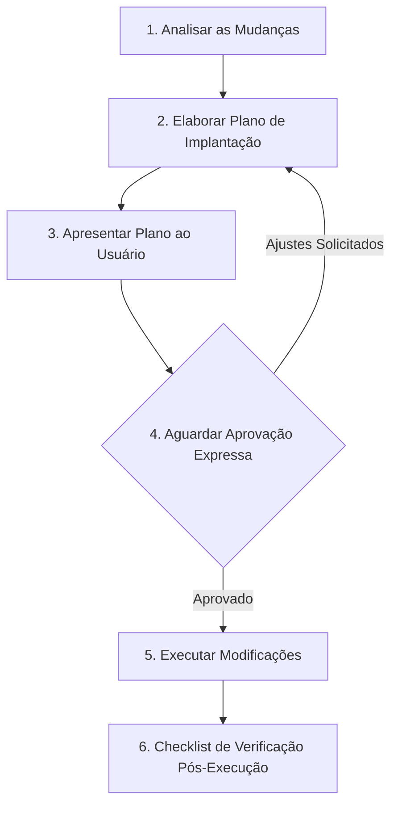

# Diretrizes do Agente de IA — Projeto Casa em Dia

Este documento contém as instruções obrigatórias, padrões arquiteturais e fluxos de verificação que qualquer agente de Inteligência Artificial deve ler, seguir e validar antes, durante e após qualquer implementação no projeto **Casa em Dia**.

---

## 1. Visão Geral do Projeto & Stack Tecnológica

O **Casa em Dia** é um aplicativo Android nativo para gestão inteligente de despensa doméstica, controle de validade de produtos e automação da lista de compras.

- **Linguagem:** Kotlin (versão 2.0+)
- **UI:** Jetpack Compose + Material 3 (100% declarativo)
- **Design System:** [`CasaEmDiaTheme`](ui/theme/Theme.kt), suporte completo a temas Claro e Escuro
- **Arquitetura:** Clean Architecture + MVVM / MVI com Unidirectional Data Flow (UDF)
- **Persistência Local:** Room Database (SQLite) com KSP e `exportSchema = true`
- **Injeção de Dependências:** Koin (`koin-android`, `koin-androidx-compose`)
- **Assincronismo & Reatividade:** Coroutines & Kotlin Flow (`StateFlow`, `SharingStarted.WhileSubscribed(5_000)`)
- **Navegação:** Jetpack Navigation Compose
- **Testes:** JUnit 4, MockK, `kotlinx-coroutines-test`

---

## 2. Princípios Arquiteturais e Separação de Camadas

Toda nova funcionalidade ou alteração deve respeitar rigorosamente a separação das camadas:

### 2.1. Camada de Domínio (`br.com.casaemdia.domain`)
- **Modelos (`domain/model`):** Data classes puras e imutáveis (`InventoryItem`, `ShoppingItem`, enums). Não devem depender de classes do Android Framework.
- **Repositórios (`domain/repository`):** Apenas interfaces puras que expõem fluxos reativos (`Flow<T>`) ou funções `suspend`.
- **Casos de Uso (`domain/usecase`):** Regras de negócio encapsuladas em classes com operador `invoke()` ou funções puras (ex: cálculo de validade, filtros, sugestões de compra).

### 2.2. Camada de Dados (`br.com.casaemdia.data`)
- **Entidades & DAOs (`data/local`):** Mapeamento relacional com Room. Toda entidade deve ter funções de conversão explícitas `toDomain()` e `toEntity()`.
- **Repositórios (`data/repository`):** Implementações concretas das interfaces de domínio consumindo os DAOs.
- **Transações:** Sempre que uma operação modificar múltiplas tabelas (ex: atualizar estoque ao marcar compra), a operação deve ser atômica.

### 2.3. Camada de Apresentação (`br.com.casaemdia.ui`)
- **ViewModels:** Expõem um único `StateFlow<UiState>` imutável utilizando `WhileSubscribed(5_000)`. Tratamento defensivo de erros (`catch`, `runCatching`).
- **Composables desacoplados:**
  - `*Screen`: Gerencia o ciclo de vida, injeção do ViewModel e repasse de lambdas de navegação/ações.
  - `*Content`: Composable que recebe apenas o `state: UiState` e callbacks de eventos. **Nunca** chame `viewModel` diretamente dentro do `*Content`. Isso é fundamental para manter os `@Preview` funcionais sem necessidade de mocks de DI.
- **Previews:** Toda tela ou componente reutilizável deve possuir `@Preview` funcional com dados simulados realistas.

---

## 3. Regras Obrigatórias de Código e Boas Práticas

### 3.1. Recursos e Internacionalização (Zero Strings Hardcoded)
- **PROIBIDO** utilizar strings literais na interface (ex: `Text("Meus itens")`).
- Sempre utilizar `stringResource(R.string.<id>)`.
- Cadastrar novas strings em `res/values/strings.xml` (e manter coerência com traduções/localização).

### 3.2. Acessibilidade (TalkBack) & UX
- Ícones que representam ações de clique devem obrigatoriamente estar envolvidos em `IconButton` e possuir `contentDescription = stringResource(...)`.
- Ícones puramente decorativos devem ter `contentDescription = null`.
- Campos de formulário com foco e teclado devem considerar `imePadding()` para não sobrepor botões ou campos inferiores.

### 3.3. Injeção de Dependências (Koin)
- Ao criar um novo ViewModel, Repositório ou Caso de Uso, registrar obrigatoriamente no arquivo [`AppModule.kt`](app/src/main/java/br/com/casaemdia/di/AppModule.kt).
- Usar `single` para instâncias persistentes (Banco, Repositórios, Clock) e `factory` para casos de uso sem estado.

### 3.4. Gerenciamento de Dependências
- Todas as dependências e versões devem ser declaradas centralizadamente no arquivo [`gradle/libs.versions.toml`](gradle/libs.versions.toml). Não adicione strings diretas de versão no `build.gradle.kts`.

### 3.5. Idioma de Comunicação do Agente
- **MANDATÓRIO:** Toda e qualquer resposta, explicação, plano de implantação, relatório ou mensagem gerada pelo agente de IA para o usuário deve ser **obrigatoriamente em Português (Brasil)**.

### 3.6. Cobertura de Testes para Novos Métodos
- **MANDATÓRIO:** Sempre que criar ou adicionar um novo método, função ou caso de uso no projeto (em qualquer camada: Domain, Data, UseCases, ViewModels ou Mappers), é obrigatorio criar/adicionar o teste unitário correspondente a este método na pasta `src/test`.

---

## 4. Protocolo Obrigatório de Trabalho da IA

Para **qualquer solicitação de alteração, refatoração ou criação de código**, o agente de IA deve obrigatoriamente seguir o fluxo abaixo:

### Passo 1: Análise Detalhada das Mudanças
- Ler integralmente os arquivos que serão impactados.
- Identificar dependências entre camadas (Domain, Data, UI, DI, Strings).
- Mapear possíveis efeitos colaterais e riscos de quebra (migrações de Room, navegação, previews ou testes existentes).

### Passo 2: Elaboração do Plano de Implantação
- **MANDATÓRIO & OBRIGATÓRIO:** Criar e/ou atualizar o arquivo temporário de plano de implantação (`implementation_plan.artifact.md`) sempre que qualquer alteração, criação ou refatoração for solicitada.
- O plano serve para exibir detalhadamente todas as alterações e aplicações que serão realizadas no código, para que o usuário possa analisar, avaliar o impacto e tomar uma decisão informada antes da aprovação.
O plano deve ser estruturado e conter:
1. **Objetivo:** Descrição clara do que será feito e por quê.
2. **Arquivos Afetados:** Lista completa com caminho de cada arquivo a ser criado, alterado ou excluído.
3. **Detalhamento das Mudanças:** Descrição cirúrgica do que mudará em cada arquivo.
4. **Impacto em Testes & Previews:** O que precisará ser adicionado ou ajustado para garantir a qualidade.

### Passo 3 & 4: Apresentar o Plano e Aguardar Aprovação (PONTO DE BLOQUEIO)
- **REGRA CRÍTICA:** A IA **NÃO DEVE** invocar nenhuma ferramenta de escrita ou alteração de código (`write_file`, `replace_file_content`, `multi_replace_file_content`) antes de apresentar o plano e receber a aprovação expressa do usuário.
- Se o usuário sugerir ajustes, o plano deve ser refinado e reapresentado.

### Passo 5: Execução Cirúrgica
- Após receber a aprovação, executar as modificações estritamente alinhadas ao plano acordado.
- Preservar comentários relevantes e estilo do código existente.

### Passo 6: Checklist de Verificação Pós-Execução
Antes de entregar a resposta final:
1. **Zero Strings Hardcoded:** Nenhuma string literal na interface.
2. **Acessibilidade:** `contentDescription` devidamente preenchido.
3. **Previews:** Previews continuam compilando e renderizando corretamente.
4. **Testes Unitários:** Atualizar ou adicionar testes unitários correspondentes em `src/test`.
5. **Validação Estática:** Sem erros de compilação, sintaxe ou imports não utilizados.
